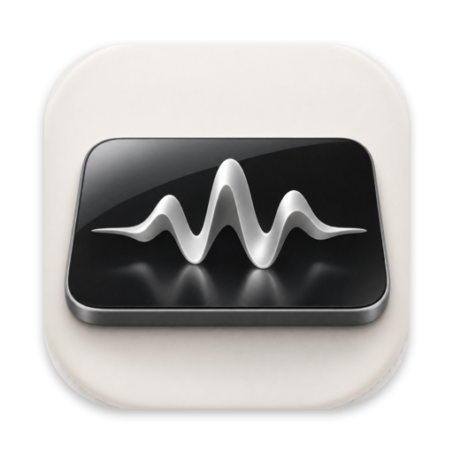
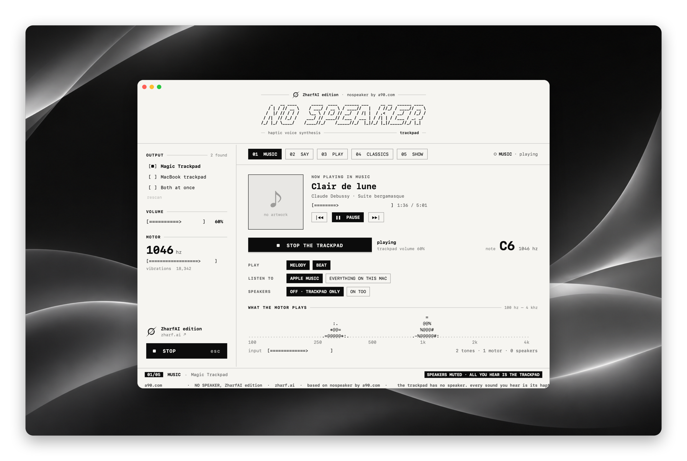
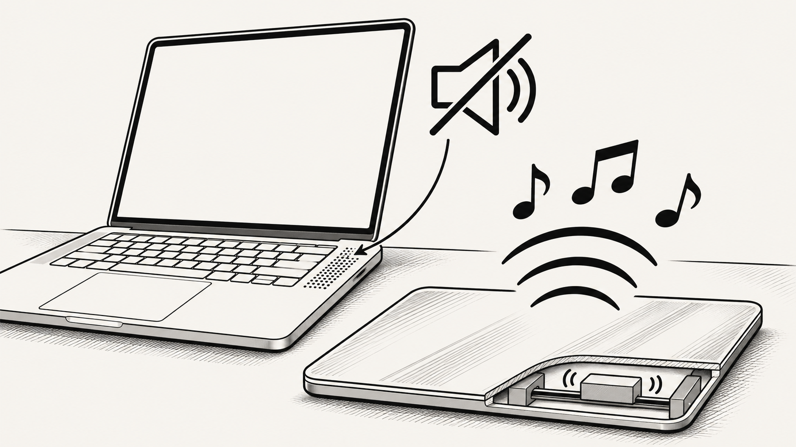
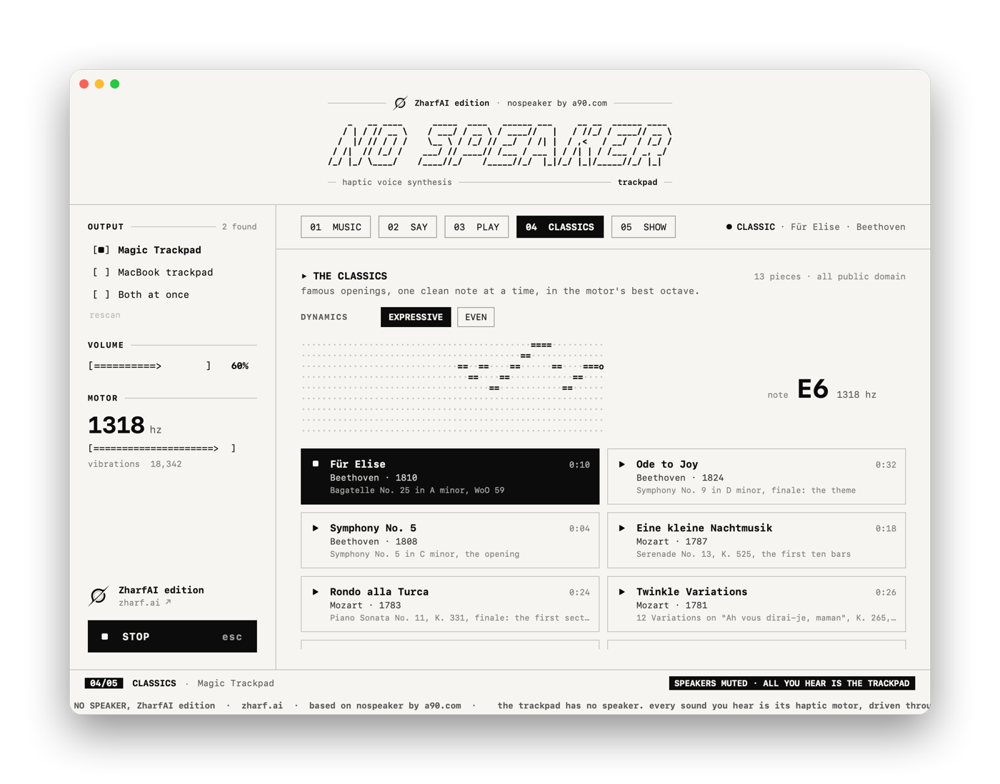
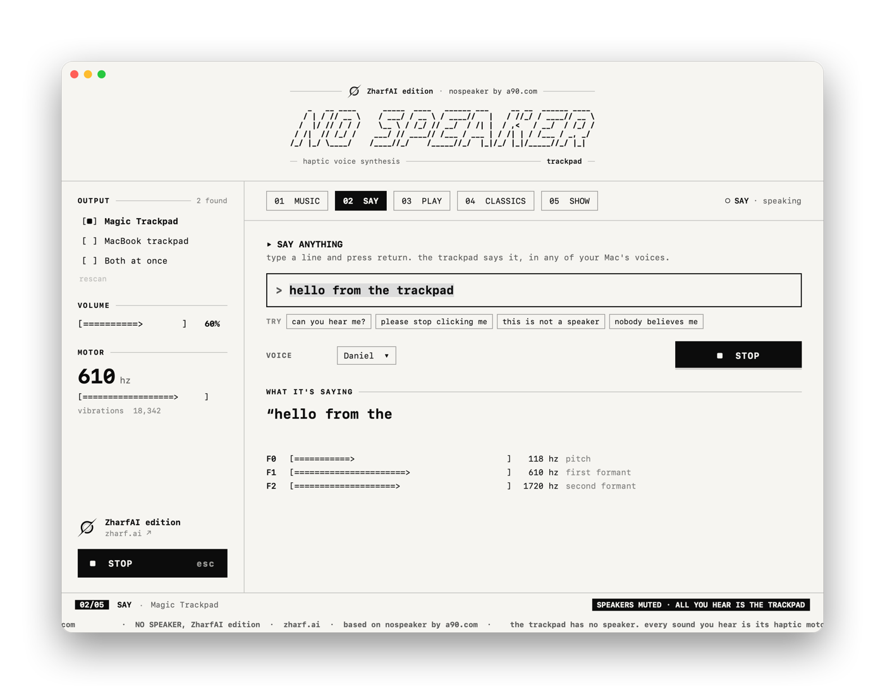
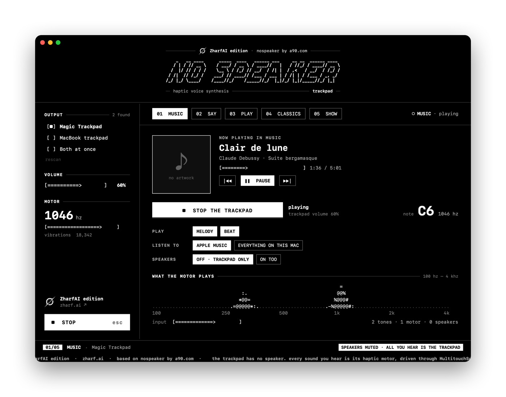

<p align="center">
  
</p>

<h1 align="center">NoSpeaker for Mac</h1>

<p align="center">
  <b>Your trackpad has no speaker. This makes it one.</b><br>
  Music, famous melodies and a voice, played through the trackpad's haptic motor.<br>
  ZharfAI's edition of <a href="https://github.com/os6/nospeaker">nospeaker</a> by Cody Collier.
</p>

<p align="center">
  <a href="https://github.com/ZharfAI/nospeaker/releases/latest"></a>
  
  
  
  <a href="LICENSE"></a>
</p>

<p align="center">
  
</p>

## What it does

<p align="center">
  
</p>

A trackpad has no speaker, just a small motor under the glass that fakes the click. NoSpeaker drives that motor
thousands of times a second, fast enough for the glass to make sound you can hear. Mute your Mac and it still
plays.

- **Music** plays Apple Music through the trackpad: the tune as one clean note, and a thump on every kick drum.
  The speakers can stay muted, so all you hear is the trackpad. (New, and still being tuned.)
- **Classics** plays famous openings by Beethoven, Mozart, Bach, Chopin, Joplin, Satie and Pachelbel, one
  clean note at a time in the motor's best octave, with expressive dynamics: phrases swell and ease off,
  downbeats lean, each note settles like a piano string.
- **Say** speaks any line, in any of your Mac's voices.
- **Play** turns the trackpad into an instrument under your finger.
- **Show** runs the heartbeat, the sweep, the melody, the beat and rap, or the whole show.
- **Output**: the MacBook's trackpad, a Magic Trackpad, or both at once, with a volume control. Stop is
  always one key away: **esc** or **⌘.**

<p align="center">
  
</p>

<p align="center">
  
  
</p>

## Download

Get **NoSpeaker-1.0.zip** from the [latest release](https://github.com/ZharfAI/nospeaker/releases/latest), unzip
it and drag **NoSpeaker** to Applications. It's signed with a Developer ID and notarized by Apple, and runs on
Apple silicon and Intel Macs with macOS 15 or later.

It needs a Force Touch trackpad: any MacBook from 2015 on, or a Magic Trackpad 2 or newer. The first time you
play music, macOS asks to let NoSpeaker record system audio and control Music.

## Build it from source

It needs Xcode 26 or later (Swift tools 6.2):

```sh
git clone https://github.com/ZharfAI/nospeaker
cd nospeaker/app
./build-app.sh install      # builds NoSpeaker.app and copies it to ~/Applications
```

More in [app/README.md](app/README.md), including how a release is signed and notarized.

## Changes to the terminal show

- **q**, **esc** or **Ctrl-C** quits at once. (It used to jump to the credits and wait there for another key.)
- `--external` plays through a Magic Trackpad, by Gavin Wang ([os6/nospeaker#2](https://github.com/os6/nospeaker/pull/2)).

Build it with `./build.sh`, then run `./nospeaker`. The original one-line installer below installs the
original build, without these changes.

Tested on a MacBook Pro (M1 Max) with macOS 27.3, on its own trackpad and a Bluetooth Magic Trackpad.

## Credits and license

- nospeaker, its sound design and the terminal show: Cody Collier ([a90.com](https://a90.com)).
- Playing through a Magic Trackpad (`--external`): Gavin Wang.
- The Mac app, music through the trackpad and the classics: [ZharfAI](https://zharf.ai/en).
- The icon, the wallpaper behind the screenshot and the illustration were made with Codex image generation
  (`design/`); the screenshots are the app's own renders (`NoSpeaker --snapshot`, composed by
  `scripts/make-images.swift`).

The code is under the [MIT License](LICENSE). The ZharfAI name and mark belong to ZharfAI and aren't covered
by it. The classics are public-domain compositions, written out for this app and checked against published
editions.

---

**The original README, as Cody Collier wrote it:**

```text
────────────────────────  a90.com presents  ─────────────────────────

    _   __ ____      _____  ____   ______ ___     __ __  ______ ____
   / | / // __ \    / ___/ / __ \ / ____//   |   / //_/ / ____// __ \
  /  |/ // / / /    \__ \ / /_/ // __/  / /| |  / ,<   / __/  / /_/ /
 / /|  // /_/ /    ___/ // ____// /___ / ___ | / /| | / /___ / _, _/
/_/ |_/ \____/    /____//_/    /_____//_/  |_|/_/ |_|/_____//_/ |_|

─  haptic voice synthesis  ─────────────────────────────  trackpad  ─
```

**Mute your Mac. Your trackpad will still talk.**

There's no speaker in a MacBook trackpad, just a small haptic motor that taps the glass so you feel a click.
NO SPEAKER drives that motor up to 4,000 times a second, fast enough to make sound you can hear, and turns it
into a voice. It talks, sings, raps, and becomes an instrument under your finger.

One command. About a minute and a half. No speakers used.

<!-- demo video: drag an .mp4 here in GitHub's editor -->

## 01 / before you start

```text
[ mute your mac ]        it still talks; that's the point
[ put it on a table ]    on your lap it's much quieter
[ hands off the glass ]  until it asks you to touch it
```

**Space** skips a part. **q**, **Esc** or **Ctrl-C** quits.

## 02 / run it

`[ one line ]`

```sh
curl -fsSL a90.com/nospeaker | sh
```

Downloads the latest release to `~/.local/bin/nospeaker` and starts the show. `a90.com/nospeaker` points
to [play.sh](play.sh) in this repo, so you can read what it runs first.

`[ download ]`

Grab `nospeaker.zip` from the [latest release](https://github.com/os6/nospeaker/releases/latest),
unzip it and run `./nospeaker` in Terminal. Signed with a Developer ID and notarized by Apple.

`[ from source ]`

Needs Xcode or the Command Line Tools (`xcode-select --install`). Builds one program for Apple Silicon
and Intel Macs.

```sh
git clone https://github.com/os6/nospeaker
cd nospeaker
./build.sh
./nospeaker
```

## 03 / play with it

```text
./nospeaker "hello there"            say anything
./nospeaker --voice Daniel "hello"   in another macOS voice
./nospeaker --sweep                  a rising tone, 100 Hz to 4 kHz

--dark                               white on black
--plain                              no visuals, plain text
--external                           play through an external Magic Trackpad
```

## 04 / needs

A Force Touch trackpad (built into MacBooks from 2015 on, or a Magic Trackpad 2 or newer), and macOS 12 or
later on Apple Silicon, or macOS 13 or later on Intel. Without a Force Touch trackpad, it says so and exits.

```text
tested on

MacBook Pro (Mac17,10)   M5 Max   macOS 27.2.1   everything works
```

Not tested yet: Intel Macs, a Magic Trackpad, and older versions of macOS. MultitouchSupport is private, so
older systems may lack the functions it uses, and loudness differs between trackpads. If you try it on another
Mac, open an issue with your model, your macOS version and how it sounded.

## 05 / how it works

```text
say ──▶ formants ──▶ two tones ──▶ motor ──▶ glass
        per 10 ms    F1 + F2       haptics   sound
```

**Why you can hear it.** The trackpad has no speaker, but the motor moves the glass. Driven back and forth
hundreds or thousands of times a second, the glass vibrates fast enough to make sound you can hear. It's quiet
because the motor is built for short taps, not for sound.

**The motor.** `MultitouchSupport` is the private framework macOS uses for the trackpad. Its function
`MTActuationCreateFromDictionary` takes a description of a vibration, a list of sine tones with a frequency,
a strength and a length each, and `MTActuationActuate` plays it on the motor. Apple's public haptics API only
offers three fixed taps.

**The range.** Measured with the MacBook's own microphone, every semitone from 98 Hz to 3,951 Hz: how loud it
is over a quiet room, and how much of the sound is the note itself.

```text
│                                      ###
│                          #+#     +++#####        #
│                         +#+#+   .+++#####       .#
│              .       ++++#+#+   .+++#####    # #.# #
│   ++        +. . #..+++++#+#++++.+++#####+ #####.###          .#
│   +++#.     +...+#..+++++#+#++++.+++#####+ #####.####+        .#
│  ++++#...   +...+#..+++++#+#++++.+++#####+.#####.####+        .#
│ .++++#...++++...+#..+++++#+#++++.+++#####+.#####.####+  +#    .#
│..++++#...++++...+#..+++++#+#++++.+++#####+.#####.####+#.+#  .#.#
│..++++#...++++...+#..+++++#+#++++.+++#####+.#####.####+#.+#+..#.#
└─────────────────────────────────────────────────────────────────
      131         262         523         1047        2093    3951
   public notes stop at 600 Hz ─┘

across: every semitone, in Hz · up: loudness, +16 to +34 dB
# clean note   + fair   . mostly buzz
```

It's loud from about 100 Hz to 4 kHz, with a few dead spots where the glass resonates. Its loudest, cleanest
notes are around 1 kHz, which covers the most important part of a voice.

**The voice.** macOS's own voice speaks the line into memory. Every 10 ms, linear prediction finds the voice's
two strongest resonances (formants), its loudness and its pitch. The motor plays those two resonances as tones,
restarted on every beat of the pitch, so they buzz like a voice instead of whistling. Hiss sounds (s, f, t)
become quick bursts of high tones. Two resonances beat three: in a blind test they were clearer, and louder,
because the motor's strength is split fewer ways.

It sounds robotic, and it's much easier to follow when you can read along, which is why the show types every
line as it speaks.

**The code.** One Swift file, [nospeaker.swift](nospeaker.swift), with no dependencies.

## 06 / caveats

- **Is it safe?** It never drives the motor past its normal maximum strength. Going past it is possible and
  louder, but the driver starts to stall, so nospeaker doesn't.
- MultitouchSupport is private and undocumented, so a macOS update could break this.

The MultitouchSupport function names were learned from the open-source Tactile project. Everything else was
measured on a MacBook.

```text
──────────────────────  thanks for listening  ───────────────────────
```

Made by [Cody Collier](https://x.com/codycollier) · [a90.com](https://a90.com) · [MIT license](LICENSE)
